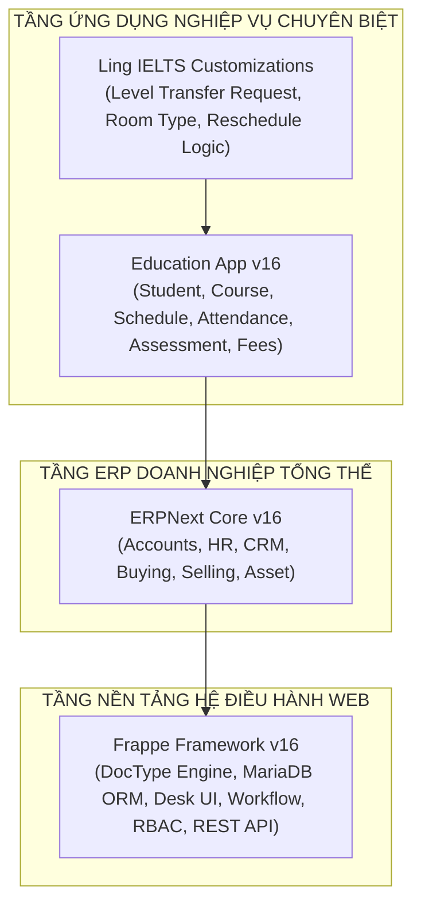
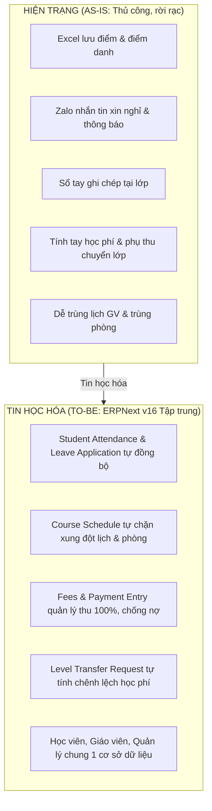

# BÁO CÁO PHÂN TÍCH HỆ THỐNG VÀ ÁNH XẠ NGHIỆP VỤ LING IELTS VÀO NỀN TẢNG ERPNEXT v16

> **Đơn vị phân tích:** Nhóm Triển khai Education ERP — Ling IELTS  
> **Căn cứ tài liệu:** *Ling IELTS — Tài liệu phân tích nghiệp vụ A1 (bản hoàn thiện)*  
> **Nền tảng mục tiêu:** Frappe Framework v16 / ERPNext v16 / Education App v16  
> **Ngày hoàn thành:** Tháng 11/2026

---

## MỤC LỤC
1. [TỔNG QUAN KIẾN TRÚC VÀ DANH MỤC MODULE CỦA ERPNEXT](#1-tổng-quan-kiến-trúc-và-danh-mục-module-của-erpnext)
2. [DANH MỤC CÁC PHÂN HỆ YÊU CẦU CỦA DỰ ÁN LING IELTS](#2-danh-mục-các-phân-hệ-yêu-cầu-của-dự-án-ling-ielts)
3. [MA TRẬN ÁNH XẠ (MAPPING) CHI TIẾT THEO 7 LUỒNG NGHIỆP VỤ](#3-ma-trận-ánh-xạ-mapping-chi-tiết-theo-7-luồng-nghiệp-vụ)
4. [ĐÁNH GIÁ MỨC ĐỘ ĐÁP ỨNG 38 BUSINESS RULES VÀ 27 USER STORIES](#4-đánh-giá-mức-độ-đáp-ứng-38-business-rules-và-27-user-stories)
5. [SO SÁNH QUY TRÌNH NGHIỆP VỤ (AS-IS) VÀ QUY TRÌNH TIN HỌC HÓA (TO-BE)](#5-so-sánh-quy-trình-nghiệp-vụ-as-is-và-quy-trình-tin-học-hóa-to-be)
6. [QUY TẮC MÃ NGUỒN VÀ CHUẨN DOCTYPE TRONG FRAPPE / ERPNEXT](#6-quy-tắc-mã-nguồn-và-chuẩn-doctype-trong-frappe--erpnext)
7. [TỔNG KẾT VÀ KẾ HOẠCH TRIỂN KHAI HOÀN THIỆN](#7-tổng-kết-và-kế-hoạch-triển-khai-hoàn-thiện)

---

## 1. TỔNG QUAN KIẾN TRÚC VÀ DANH MỤC MODULE CỦA ERPNEXT

### 1.1. Kiến trúc phân tầng của hệ sinh thái Frappe / ERPNext
Hệ thống được thiết kế theo mô hình **Metadata-Driven Architecture** (Kiến trúc hướng siêu dữ liệu) chia làm 3 tầng chính:



### 1.2. Danh mục chi tiết các Module hiện có sẵn trên hệ thống

| Tầng ứng dụng | Module chính | Mô tả chức năng cốt lõi | DocTypes tiêu biểu |
| :--- | :--- | :--- | :--- |
| **Education App** | **Student** | Quản lý vòng đời học viên, hồ sơ cá nhân, tuyển sinh, người giám hộ | `Student`, `Student Applicant`, `Guardian`, `Student Guardian`, `Student Log` |
| **Education App** | **Course & Scheduling** | Khóa học, môn học, khung chương trình, phân lớp, xếp thời khóa biểu | `Program`, `Course`, `Student Group`, `Course Schedule`, `Room`, `Instructor` |
| **Education App** | **Student Attendance** | Quản lý chuyên cần, điểm danh lớp, theo dõi học viên xin nghỉ | `Student Attendance`, `Student Attendance Tool`, `Student Leave Application` |
| **Education App** | **Assessment** | Khảo thí, kế hoạch thi, tiêu chí chấm điểm, bảng điểm, thang điểm | `Assessment Plan`, `Assessment Criteria`, `Assessment Result`, `Grading Scale` |
| **Education App** | **Fees** | Quản lý biểu phí đào tạo, tạo phiếu báo thu, thanh toán học phí | `Fee Structure`, `Fee Category`, `Fees`, `Fee Schedule` |
| **ERPNext Core** | **Accounts** | Hạch toán kế toán, hóa đơn bán hàng, phiếu thu tiền, theo dõi công nợ | `Sales Invoice`, `Payment Entry`, `Journal Entry`, `Payment Request` |
| **ERPNext Core** | **HR (Human Resources)** | Quản lý nhân sự giáo viên, chấm công, hợp đồng, đơn nghỉ phép nhân viên | `Employee`, `Leave Application`, `Department`, `Designation` |
| **ERPNext Core** | **CRM** | Chăm sóc khách hàng tiềm năng, tiếp nhận đầu mối học viên đăng ký | `Lead`, `Opportunity`, `Customer` |
| **Frappe Core** | **Core & Workflow** | Quản lý người dùng, phân quyền (RBAC), quy trình phê duyệt nhiều bước | `User`, `Role`, `Custom DocPerm`, `Workflow`, `Workflow State` |
| **Frappe Core** | **Customization** | Tùy biến schema, viết script mở rộng không sửa core mã nguồn | `DocType`, `Custom Field`, `Client Script`, `Server Script` |

---

## 2. DANH MỤC CÁC PHÂN HỆ YÊU CẦU CỦA DỰ ÁN LING IELTS
Theo tài liệu phân tích nghiệp vụ A1, trung tâm Ling IELTS có quy mô hơn 100 học viên, 6 giáo viên (Việt Nam và nước ngoài), hơn 10 phòng học, vận hành khóa học 3 tháng (2 buổi/tuần, 2 giờ/buổi). Hệ thống chia làm **7 phân hệ nghiệp vụ cốt lõi**:

1. **Phân hệ 1: Quản lý Hồ sơ học viên & Tuyển sinh (Luồng 1)**  
   Quản lý thông tin học viên, người giám hộ (dưới 18 tuổi), kết quả kiểm tra đầu vào 4 kỹ năng (L, S, R, W), tự động làm tròn band điểm 0.5 và lưu lịch sử cấp độ.
2. **Phân hệ 2: Quản lý Khóa học & Lập lịch giảng dạy (Luồng 2)**  
   Xếp lịch khóa học 3 tháng (24 buổi), phân công giáo viên, tự động phát hiện và chặn trùng lịch giáo viên (BR-SCH-01).
3. **Phân hệ 3: Quản lý Cơ sở vật chất & Phân bổ phòng học (Luồng 3)**  
   Quản lý danh mục phòng học, phân loại phòng (Giảng dạy chung, Speaking, Listening), tự động chặn trùng phòng (BR-ROOM-01) và gợi ý đúng loại phòng.
4. **Phân hệ 4: Quản lý Học phí & Thu tiền (Luồng 4)**  
   Bảng giá học phí theo band điểm IELTS (3.5tr đến 8tr), chính sách giảm giá, yêu cầu thu đủ 100% học phí mới cho vào lớp, không cho nợ học phí.
5. **Phân hệ 5: Khảo thí, Đánh giá & Chuyển cấp độ học viên (Luồng 5)**  
   Nhập điểm kiểm tra tuần/tháng, điều kiện xét chuyển cấp (vượt chuẩn 4 tuần liên tiếp hoặc GV đề xuất), tự động tính phụ thu học phí theo số buổi còn lại.
6. **Phân hệ 6: Quản lý Giáo viên & Điều phối Dạy bù / Đổi giáo viên (Luồng 6)**  
   Tiếp nhận đơn báo nghỉ của giáo viên, quy trình 4 bước ưu tiên xử lý (Lùi lịch -> Đổi GV cùng band -> Xếp lịch dạy bù -> Đề xuất học online).
7. **Phân hệ 7: Quản lý Nghỉ học của Học viên & Điểm danh lớp (Luồng 7)**  
   Học viên nộp đơn xin nghỉ trước giờ học >= 30 phút, Giáo viên phụ trách lớp phê duyệt, tự động đồng bộ trạng thái Vắng có phép vào công cụ điểm danh.

---

## 3. MA TRẬN ÁNH XẠ (MAPPING) CHI TIẾT THEO 7 LUỒNG NGHIỆP VỤ

### Bảng tổng hợp mức độ đáp ứng Out-of-the-Box (OOTB):

| STT | Luồng nghiệp vụ Ling IELTS | DocTypes OOTB tương ứng trong ERPNext/Education | Mức độ đáp ứng OOTB | Khoảng trống (Gaps) cần tùy biến |
| :---: | :--- | :--- | :---: | :--- |
| **L1** | Quản lý thông tin học viên | `Student`, `Student Applicant`, `Guardian`, `Student Guardian` | **85%** | Cần lưu 4 kỹ năng test đầu vào và công thức tính band tổng làm tròn 0.5 (BR-STU-03). |
| **L2** | Xếp lịch giảng dạy | `Academic Year`, `Academic Term`, `Program`, `Student Group`, `Course Schedule` | **90%** | ERPNext OOTB đã có sẵn hàm `validate_overlap()` chặn trùng lịch GV. Cần bổ sung gợi ý GV rảnh cùng cấp độ. |
| **L3** | Phân bổ phòng học | `Room`, `Course Schedule` | **80%** | ERPNext OOTB đã chặn trùng phòng. Cần bổ sung trường `Room Type` (Speaking, Listening...) và validate đúng loại phòng. |
| **L4** | Theo dõi thu học phí | `Fee Structure`, `Fee Category`, `Fees`, `Payment Entry` | **85%** | Đã có sẵn lập hóa đơn và thu tiền. Cần rule chặn ghi danh nếu chưa đóng đủ 100% tiền (BR-FEE-03). |
| **L5** | Kết quả học tập & Chuyển cấp | `Assessment Plan`, `Assessment Criteria`, `Assessment Result` | **50%** | Nhập điểm tuần/tháng có sẵn 95%. Nhưng **chuyển cấp và tự động tính phụ thu** OOTB hoàn toàn không có. |
| **L6** | Giáo viên xin nghỉ & Lịch dạy bù | `Instructor`, `Course Schedule`, `Employee Leave Application` | **40%** | OOTB chỉ có đơn nghỉ phép nhân sự chung, thiếu luồng gắn với buổi học và logic 4 bước ưu tiên điều phối lịch. |
| **L7** | Học viên xin nghỉ & Điểm danh | `Student Leave Application`, `Student Attendance`, `Student Attendance Tool` | **85%** | OOTB tự động đồng bộ đơn nghỉ vào Attendance. Cần ràng buộc gửi trước 30p và chỉ GV phụ trách mới được duyệt. |
| **Tổng thể** | **Toàn bộ hệ thống** | **ERPNext + Education v16** | **~74%** | **Cần tùy biến 26% (2 Custom DocTypes + 4 Scripts + Custom Fields)** |

---

### Chi tiết phân tích từng luồng:

#### Luồng 1: Quản lý thông tin học viên & Tuyển sinh
- **Đã có sẵn (OOTB):**
  - `Student`: Lưu trữ đầy đủ lý lịch học viên, liên kết User account, ảnh đại diện, tình trạng học tập.
  - `Guardian` & `Student Guardian`: Quản lý phụ huynh/người bảo hộ, số điện thoại, email (đáp ứng BR-STU-02).
  - `Student Applicant`: Hồ sơ ứng viên khi mới đến tư vấn.
- **Khoảng trống & Giải pháp (Gaps & Customizations):**
  - *Gap:* OOTB chưa có bảng điểm 4 kỹ năng đầu vào chuẩn IELTS kèm làm tròn 0.5.
  - *Giải pháp:* Thêm Custom Fields vào `Student` hoặc `Student Applicant`:
    - `listening_score`, `speaking_score`, `reading_score`, `writing_score` (Float, thang 0–9).
    - `overall_band`: Tự động tính trung bình cộng và làm tròn đến `0.5` gần nhất qua Client/Server script.
    - `initial_level`: Tự động map vào cấp độ tương ứng theo bảng giá (BR-STU-05).

#### Luồng 2: Xếp lịch giảng dạy
- **Đã có sẵn (OOTB):**
  - `Academic Year`: Lưu năm học.
  - `Academic Term`: Lưu khóa học (khóa 3 tháng của Ling IELTS).
  - `Program`: 5 cấp độ IELTS (3.0-3.5, 4.0-4.5, 5.0-5.5, 6.0-6.5, 7.0-8.0).
  - `Student Group`: Lớp học cụ thể (tối đa 10-15 học viên).
  - `Course Schedule`: Mỗi bản ghi đại diện cho 1 buổi học (gồm: Lớp, Môn, Giáo viên, Phòng, Ngày học, Từ giờ - Đến giờ).
  - **Đặc biệt:** Basecode của `CourseSchedule.validate_overlap()` trong `apps/education/.../course_schedule.py` **đã tích hợp sẵn thuật toán chặn trùng lịch giáo viên**:
    ```python
    validate_overlap_for(self, "Course Schedule", "instructor")
    ```
    -> Đáp ứng ngay lập tức 100% yêu cầu `BR-SCH-01`, `US-04`, `AC-04.1`.

#### Luồng 3: Phân bổ phòng học
- **Đã có sẵn (OOTB):**
  - `Room`: Quản lý danh mục phòng, sức chứa (`capacity`).
  - `Course Schedule`: Gán phòng cho buổi học.
  - Basecode `CourseSchedule.validate_overlap()` **đã có sẵn thuật toán chặn trùng phòng**:
    ```python
    validate_overlap_for(self, "Course Schedule", "room")
    ```
    -> Đáp ứng 100% yêu cầu `BR-ROOM-01` và `US-09` (AC-09.1).
- **Khoảng trống & Giải pháp:**
  - *Gap:* Mặc định `Room` không phân loại phòng chuyên biệt (Phòng học thường, phòng Listening có tai nghe, phòng Speaking phỏng vấn).
  - *Giải pháp:* Đã tạo Custom Field `custom_room_type` (Select: *Phòng giảng dạy*, *Phòng Speaking*, *Phòng Listening*) trong [`custom_doctypes/custom/room.json`](file:///d:/my-projects/cshttt/custom_doctypes/custom/room.json). Khi xếp lịch kiểm tra phòng phải đúng loại yêu cầu của buổi học (AC-08.1).

#### Luồng 4: Theo dõi thu học phí
- **Đã có sẵn (OOTB):**
  - `Fee Category`: Định nghĩa khoản thu (Học phí, Phụ thu chuyển cấp, Giáo trình).
  - `Fee Structure`: Biểu phí chuẩn cho từng Program (khóa 3.0-3.5: 3.5tr; 7.0-8.0: 8tr).
  - `Fees`: Phiếu báo học phí cho từng học viên, hỗ trợ các dòng phụ phí hoặc giảm trừ (Discount).
  - `Payment Entry`: Phiếu thu tiền (Tiền mặt, Chuyển khoản), gạch nợ trực tiếp cho phiếu `Fees`.
- **Khoảng trống & Giải pháp:**
  - *Gap:* OOTB cho phép học viên ghi danh vào lớp trước rồi thu tiền sau (`outstanding_amount > 0`). Quy tắc `BR-FEE-03` của Ling IELTS yêu cầu **bắt buộc thu đủ 100% mới cho vào lớp**.
  - *Giải pháp:* Thêm validation trên `Student Group Student` hoặc `Program Enrollment`: Chặn lưu nếu học viên chưa có chứng từ `Fees` với `outstanding_amount == 0`.

#### Luồng 5: Kết quả học tập & Đánh giá chuyển cấp độ
- **Đã có sẵn (OOTB):**
  - `Assessment Criteria`: 4 kỹ năng (Listening, Speaking, Reading, Writing).
  - `Assessment Plan`: Kế hoạch kiểm tra tuần (Weekly Test) hoặc tháng (Monthly Test).
  - `Assessment Result`: Bảng nhập điểm chi tiết từng kỹ năng và điểm trung bình cho học sinh.
  - `Grading Scale`: Thang điểm IELTS 0–9.0.
- **Khoảng trống & Giải pháp:**
  - *Gap lớn:* ERPNext không có quy trình nghiệp vụ cho việc học viên tiến bộ vượt bậc giữa kỳ và chuyển lên lớp cao hơn kèm tính toán học phí chênh lệch.
  - *Giải pháp:* **Custom DocType `Level Transfer Request`** (Đã tạo trong [`custom_doctypes/level_transfer_request/`](file:///d:/my-projects/cshttt/custom_doctypes/level_transfer_request)):
    - Lưu: Học viên, Lớp hiện tại, Lớp mới, Học phí cũ, Học phí mới, Tổng số buổi, Số buổi còn lại.
    - Client Script tự động tính:
      $$\text{Phụ thu} = (\text{Học phí mới} - \text{Học phí cũ}) \times \frac{\text{Số buổi còn lại}}{\text{Tổng số buổi}}$$
    - Server Controller Python kiểm tra quy tắc `BR-TR-08` (chỉ cho phép chuyển lên cấp cao hơn) và tự động tạo phiếu `Fees` phụ thu khi Quản lý chấp thuận.

#### Luồng 6: Giáo viên xin nghỉ & Điều phối lịch dạy
- **Đã có sẵn (OOTB):**
  - `Instructor`: Hồ sơ giáo viên.
  - `Leave Application` (Module HR): Nghỉ phép hành chính của nhân viên.
- **Khoảng trống & Giải pháp:**
  - *Gap lớn:* Đơn nghỉ phép của HR không liên kết với buổi dạy cụ thể (`Course Schedule`) và không có cơ chế hỗ trợ điều phối lịch học của trung tâm.
  - *Giải pháp:* Tạo Custom DocType `Instructor Reschedule Request`:
    - Giáo viên chọn buổi học cụ thể cần báo nghỉ (`course_schedule`), nhập lý do (`reason`).
    - Hệ thống gợi ý 4 phương án theo thứ tự ưu tiên (`BR-TCH-03`):
      1. Lùi lịch sang khung giờ khác trong tuần của cùng giáo viên.
      2. Đổi sang giáo viên khác có cùng cấp độ chuyên môn và đang rảnh.
      3. Xếp lịch dạy bù vào buổi trống trước khi khóa kết thúc.
      4. Chuyển hình thức sang học trực tuyến (Online).

#### Luồng 7: Học viên xin nghỉ & Điểm danh lớp
- **Đã có sẵn (OOTB):**
  - `Student Leave Application`: Học viên nộp đơn xin nghỉ, chọn từ ngày đến ngày, lý do.
  - `Student Attendance Tool`: Giao diện điểm danh nhanh theo lớp.
  - Basecode của `StudentLeaveApplication.update_attendance()` **đã có sẵn cơ chế tự động**: Khi đơn nghỉ được Submit, hệ thống tự động sinh bản ghi `Student Attendance` với trạng thái `"Leave"` (Vắng có phép)!
- **Khoảng trống & Giải pháp:**
  - *Gap 1 (BR-LEAVE-05):* Đơn phải gửi trước giờ học ít nhất 30 phút. Quá hạn hệ thống tự động từ chối.
  - *Gap 2 (BR-LEAVE-06):* Chỉ Giáo viên phụ trách lớp mới có quyền duyệt đơn xin nghỉ, Quản lý chỉ được quyền xem (Read-only).
  - *Giải pháp:* Viết hook `before_insert` kiểm tra thời gian gửi đơn so với `Course Schedule.from_time` và cấu hình Role/Permission cho Giáo viên.

---

## 4. ĐÁNH GIÁ MỨC ĐỘ ĐÁP ỨNG 38 BUSINESS RULES VÀ 27 USER STORIES

### 4.1. Bảng đối soát 38 Business Rules (BR)

| Nhóm quy tắc | Mã Rule | Tóm tắt nội dung quy tắc | Hiện trạng trong ERPNext | Giải pháp thực hiện |
| :--- | :--- | :--- | :---: | :--- |
| **Hồ sơ học viên** | `BR-STU-01` | Một hồ sơ duy nhất xuyên suốt các khóa | **OOTB 100%** | Dùng `Student` ID duy nhất. |
| | `BR-STU-02` | Học viên < 18 tuổi phải có phụ huynh | **OOTB 90%** | Bắt buộc trường `guardians` trong `Student`. |
| | `BR-STU-03` | Test đầu vào 4 kỹ năng, làm tròn 0.5 | **Cần tùy biến** | Client script tính `overall_band` làm tròn 0.5. |
| | `BR-STU-04` | Lưu lịch sử cấp độ, không ghi đè | **OOTB 100%** | Bảng con `Program Enrollment` lưu lịch sử từng khóa. |
| | `BR-STU-05` | Chỉ nhận học viên band 3.0 - 8.0 | **Cần tùy biến** | Validate trên form `Student Applicant`. |
| **Học phí** | `BR-FEE-01` | Cho phép áp dụng giảm giá học phí | **OOTB 100%** | Component `Discount` trên `Fees`. |
| | `BR-FEE-02` | Học phí = Biểu phí cấp độ - Giảm giá | **OOTB 100%** | Cơ chế tự động tính `grand_total` của `Fees`. |
| | `BR-FEE-03` | Bắt buộc đóng đủ 100% mới xếp lớp | **Cần tùy biến** | Server script chặn thêm vào `Student Group`. |
| | `BR-FEE-04` | Giảm giá không được vượt quá học phí | **OOTB 100%** | ERPNext không cho hóa đơn âm. |
| **Chuyển cấp độ** | `BR-TR-01` | Đủ điều kiện: Vượt band 4 tuần hoặc GV đề xuất | **Cần tùy biến** | Query từ `Assessment Result` hoặc nút đề xuất. |
| | `BR-TR-02` | Công thức tính phụ thu theo buổi còn lại | **Đã tùy biến** | Đã viết xong trong `Level Transfer Request`. |
| | `BR-TR-03` | Đồng ý chuyển -> Đổi lớp và tạo phí | **Đã tùy biến** | Script tự cập nhật `Student Group` & tạo `Fees`. |
| | `BR-TR-04` | Từ chối chuyển -> Giữ nguyên lớp và lưu log | **Đã tùy biến** | Trạng thái `Rejected` trên `Level Transfer Request`. |
| | `BR-TR-05` | Tiêu chí vượt mức cấp độ hiện tại | **Cần tùy biến** | Logic đánh giá điểm so với ngưỡng chương trình. |
| | `BR-TR-06` | Số buổi còn lại = Buổi chưa diễn ra | **Đã tùy biến** | Đếm `Course Schedule` có `schedule_date >= Today`. |
| | `BR-TR-07` | Phụ thu phải đóng đủ trước khi vào lớp mới | **Cần tùy biến** | Check `outstanding_amount` của phiếu phụ thu. |
| | `BR-TR-08` | Chỉ hỗ trợ chuyển lên, không chuyển xuống | **Đã tùy biến** | Đã validate trong `level_transfer_request.py`. |
| **Lịch dạy & Phòng**| `BR-SCH-01` | Không xếp trùng giờ cùng một giáo viên | **OOTB 100%** | `CourseSchedule.validate_overlap()` tích hợp sẵn. |
| | `BR-SCH-02` | Ưu tiên đổi GV cùng cấp độ / học online | **Cần tùy biến** | Form xử lý của `Instructor Reschedule Request`. |
| | `BR-SCH-03` | Số buổi nợ phải dạy bù trước khi hết khóa | **Cần tùy biến** | Báo cáo đối soát số buổi dạy thực tế/kế hoạch. |
| | `BR-ROOM-01`| Không xếp trùng phòng cùng khung giờ | **OOTB 100%** | `CourseSchedule.validate_overlap()` tích hợp sẵn. |
| | `BR-ROOM-02`| Phòng phải đúng loại yêu cầu của buổi học | **Đã tùy biến** | Đã thêm `custom_room_type` trên `Room`. |
| **Điểm danh & Nghỉ**| `BR-ATT-01` | Điểm danh đầy đủ danh sách học viên | **OOTB 100%** | `Student Attendance Tool` load danh sách lớp. |
| | `BR-ATT-02` | 3 trạng thái: Có mặt / Có phép / Không phép | **OOTB 100%** | `Present`, `Leave`, `Absent` trong Attendance. |
| | `BR-ATT-03` | Vắng cá nhân không phát sinh dạy bù | **OOTB 100%** | Quy định quy trình, không can thiệp lịch. |
| | `BR-ATT-04` | Dữ liệu điểm danh lưu tập trung | **OOTB 100%** | Lưu vào bảng cơ sở dữ liệu `tabStudent Attendance`. |
| | `BR-TCH-01` | GV báo nghỉ trước ít nhất 1 ngày | **Cần tùy biến** | Kiểm tra `diff_days(schedule_date, today) >= 1`. |
| | `BR-TCH-02` | Đơn nghỉ GV phải được Quản lý phê duyệt | **OOTB 100%** | Phân quyền Workflow cho Quản lý trung tâm. |
| | `BR-TCH-03` | Thứ tự: Lùi lịch -> Đổi GV -> Bù -> Online | **Cần tùy biến** | Hỗ trợ trên giao diện xử lý của Quản lý. |
| | `BR-TCH-04` | Khóa học phải đủ 24 buổi | **Cần tùy biến** | Script kiểm tra trước khi hoàn thành khóa. |
| | `BR-LEAVE-01`| Học viên tạo yêu cầu xin nghỉ trên hệ thống | **OOTB 100%** | Sử dụng DocType `Student Leave Application`. |
| | `BR-LEAVE-02`| Trạng thái đơn: Chờ duyệt / Chấp thuận / Từ chối| **OOTB 100%** | Workflow State chuẩn trên DocType. |
| | `BR-LEAVE-03`| Đơn chấp thuận -> Tự động Vắng có phép | **OOTB 100%** | Hàm `update_attendance()` có sẵn trong core. |
| | `BR-LEAVE-04`| Không phép hoặc bị từ chối -> Vắng không phép| **OOTB 100%** | Trạng thái `Absent` trong điểm danh. |
| | `BR-LEAVE-05`| Đơn phải gửi trước buổi học ít nhất 30 phút | **Cần tùy biến** | Validate thời gian trước khi `insert`. |
| | `BR-LEAVE-06`| GV phụ trách lớp duyệt, Quản lý chỉ xem | **Cần tùy biến** | Permission Rule theo `Student Group Instructor`. |
| | `BR-LEAVE-07`| GV chưa duyệt trước giờ học -> Xử lý tự động | **Cần tùy biến** | Scheduled Task kiểm tra trước giờ học. |
| **Ghi danh & Lớp** | `BR-ENR-01`..03| Quy định hoàn phí, vào giữa khóa, sĩ số | **Cần chốt** | Cài đặt thông số trên `Education Settings`. |

---

## 5. SO SÁNH QUY TRÌNH NGHIỆP VỤ (AS-IS) VÀ QUY TRÌNH TIN HỌC HÓA (TO-BE)

### Bảng chuyển đổi 7 luồng vận hành cốt lõi:



| Luồng | Quy trình nghiệp vụ hiện tại (AS-IS) | Quy trình tin học hóa trên ERPNext (TO-BE) | Điểm tự động hóa / Cải tiến vượt bậc |
| :--- | :--- | :--- | :--- |
| **L1: Hồ sơ học viên** | Ghi sổ tay khi tư vấn, lưu điểm test Excel, dễ thất lạc lịch sử tiến bộ khi học nhiều khóa. | Quản lý tạo `Student Applicant`, nhập điểm 4 kỹ năng test. Chuyển thành `Student` chỉ bằng 1 click. | Tự động tính band tổng làm tròn 0.5; liên kết chặt chẽ thông tin phụ huynh; lịch sử học tập lưu vĩnh viễn. |
| **L2: Xếp lịch dạy** | Quản lý dò lịch trên file Excel, mất ~8 giờ/khóa, thường xuyên xảy ra trùng giờ giáo viên (2-3 vụ/khóa). | Tạo lịch trên `Course Schedule`. Nhập lớp, giáo viên, khung giờ. | **Hệ thống chặn ngay lập tức nếu trùng lịch giáo viên** (`validate_overlap`). Rút ngắn thời gian xếp lịch còn < 2 giờ. |
| **L3: Phân bổ phòng** | Nhớ và nháp phòng trên giấy, dễ nhầm phòng Speaking thành phòng thường, dễ trùng phòng. | Chọn phòng trên `Course Schedule`. Hệ thống lọc theo `Room Type`. | **Chặn trùng phòng 100%**. Cảnh báo nếu chọn sai loại phòng chuyên dụng (Speaking/Listening). |
| **L4: Theo dõi học phí** | Ghi sổ tiền mặt/tra cứu sao kê ngân hàng, đối chiếu Excel mất 5-10 phút/học sinh, sai lệch ~5%. | Tạo chứng từ `Fees`, thu qua `Payment Entry`. Trạng thái `Paid` hiển thị rõ ràng trên hồ sơ. | Không cần tính nhẩm; kiểm tra đóng phí < 1 phút; **chặn học viên chưa đóng đủ 100% vào danh sách lớp**. |
| **L5: Kết quả & Chuyển cấp** | Giáo viên tự chấm và gửi Zalo, chuyển cấp tính tiền nhẩm bằng tay dẫn đến tranh cãi hoặc sai tiền. | Nhập điểm trực tiếp vào `Assessment Result`. Tạo đề xuất `Level Transfer Request`. | **Tự động tính phụ thu theo đúng công thức**: $(\Delta \text{Học phí}) \times (\text{Buổi còn lại} / \text{Tổng buổi})$. |
| **L6: Giáo viên báo nghỉ** | Nhắn tin Zalo gấp, quản lý gọi điện tìm người thay, mất ~1 ngày làm việc, dễ quên buổi dạy bù. | Giáo viên gửi `Instructor Reschedule Request` trên hệ thống. Quản lý duyệt và chọn giải pháp. | Tự động kiểm tra lịch rảnh của giáo viên khác cùng band; theo dõi chặt chẽ số buổi dạy nợ của từng lớp. |
| **L7: Học viên xin nghỉ** | Nhắn Zalo cho giáo viên hoặc quản lý, giáo viên vào lớp ghi sổ, cuối tháng tổng kết điểm danh thủ công. | Học viên gửi `Student Leave Application` trước >= 30p. Giáo viên duyệt trên web/app. | **Khi giáo viên mở điểm danh, hệ thống đã tự điền sẵn 'Vắng có phép'** cho học viên đã duyệt đơn. |

---

## 6. QUY TẮC MÃ NGUỒN VÀ CHUẨN DOCTYPE TRONG FRAPPE / ERPNEXT

Để đảm bảo mã nguồn viết mới chuẩn hóa, dễ bảo trì, dễ nâng cấp và không xung đột khi cập nhật hệ thống, toàn bộ thành viên trong nhóm cần tuân thủ các quy tắc sau:

### 6.1. Chuẩn cấu trúc thư mục của một DocType
Mỗi DocType trong Frappe là một module khép kín gồm 5 thành phần chuẩn:

```
custom_doctypes/level_transfer_request/
├── __init__.py                       # Khai báo package Python
├── level_transfer_request.json       # Metadata Schema (Định nghĩa field, link, quyền, index)
├── level_transfer_request.py         # Controller xử lý phía Server (Python class kế thừa Document)
├── level_transfer_request.js         # Controller xử lý giao diện Client (JavaScript Form events)
└── test_level_transfer_request.py    # Kịch bản kiểm thử tự động (Unit Test)
```

### 6.2. Vòng đời Document Controller (Server-side Lifecycle)
Mọi xử lý nghiệp vụ, kiểm tra ràng buộc dữ liệu (Validation) và tác vụ tự động cần được đặt đúng hàm hook trong file `.py`:

```python
from frappe.model.document import Document
import frappe
from frappe import _

class LevelTransferRequest(Document):
    def validate(self):
        """1. Chạy mỗi khi người dùng bấm Lưu (Save). Dùng để kiểm tra tính hợp lệ dữ liệu."""
        if self.new_fee < self.current_fee:
            frappe.throw(_("Chỉ cho phép chuyển lên cấp độ cao hơn (BR-TR-08)."))
        self.calculate_fee()

    def before_submit(self):
        """2. Chạy trước khi Submit. Kiểm tra điều kiện tiên quyết để được phê duyệt."""
        if self.status != "Approved":
            frappe.throw(_("Chỉ có thể nộp đề xuất khi đã được Quản lý Chấp thuận."))

    def on_submit(self):
        """3. Chạy ngay sau khi Submit thành công (docstatus = 1). Dùng để sinh chứng từ kế toán/đổi lớp."""
        self.create_additional_fee_invoice()
        self.update_student_class()

    def on_cancel(self):
        """4. Chạy khi Hủy chứng từ (docstatus = 2). Dùng để hoàn tác dữ liệu."""
        self.cancel_additional_fee_invoice()
```

### 6.3. Chuẩn viết Client Script (Form UI Lifecycle)
Không viết DOM trực tiếp, luôn sử dụng Frappe Form API trong file `.js`:

```javascript
frappe.ui.form.on('Level Transfer Request', {
    refresh: function(frm) {
        // Chạy khi mở form
        if (frm.doc.status === 'Approved' && frm.doc.docstatus === 0) {
            frm.add_custom_button(__('Tạo phiếu phụ thu'), function() {
                frm.trigger('create_fee_voucher');
            }).addClass('btn-primary');
        }
    },
    
    current_fee: function(frm) {
        // Trigger khi thay đổi giá trị field current_fee
        frm.trigger('calculate_difference');
    },

    new_fee: function(frm) {
        frm.trigger('calculate_difference');
    },

    calculate_difference: function(frm) {
        if (frm.doc.new_fee && frm.doc.current_fee && frm.doc.total_sessions) {
            let diff = frm.doc.new_fee - frm.doc.current_fee;
            let fee = (diff * (frm.doc.remaining_sessions || 0)) / frm.doc.total_sessions;
            frm.set_value('additional_fee', Math.max(0, fee));
        }
    }
});
```

### 6.4. Phân biệt các loại DocType trong kiến trúc
1. **Normal DocType (Master Data):** Lưu trữ danh mục (`Student`, `Instructor`, `Room`). `is_submittable = 0`.
2. **Submittable DocType (Transactional Data):** Chứng từ giao dịch, có vòng đời 3 trạng thái (`docstatus`):
   - `0: Draft` (Bản nháp, chỉnh sửa tự do).
   - `1: Submitted` (Đã duyệt/Khóa sổ, không được sửa trực tiếp, sinh GL/Attendance).
   - `2: Cancelled` (Đã hủy, lưu dấu vết kiểm toán).
   *(Áp dụng cho: `Fees`, `Level Transfer Request`, `Student Attendance`, `Payment Entry`).*
3. **Child Table DocType:** Bảng con lồng trong form chính (Ví dụ: Danh sách chi tiết điểm 4 kỹ năng trong `Assessment Result Detail`, chi tiết học phí trong `Fee Component`).
4. **Single DocType:** Lưu cấu hình dùng chung toàn hệ thống (`Education Settings`).

### 6.5. Nguyên tắc vàng về Tùy biến mã nguồn (Non-invasive Customization)
- **Tuyệt đối không sửa code trực tiếp trong thư mục `apps/frappe` hoặc `apps/erpnext`**: Việc sửa code core sẽ khiến hệ thống không thể nâng cấp (`git pull` bị conflict) và mất toàn bộ tùy biến khi rebuild Docker.
- **Mọi tùy biến phải được lưu trữ trong:**
  1. Thư mục mã nguồn riêng: [`custom_doctypes/`](file:///d:/my-projects/cshttt/custom_doctypes/) trên máy host.
  2. Đồng bộ tự động vào Docker container thông qua script [`push.ps1`](file:///d:/my-projects/cshttt/push.ps1) và [`pull.ps1`](file:///d:/my-projects/cshttt/pull.ps1).
  3. Dữ liệu cấu hình master data được sao lưu qua [`export_data.ps1`](file:///d:/my-projects/cshttt/export_data.ps1).

---

## 7. TỔNG KẾT VÀ KẾ HOẠCH TRIỂN KHAI HOÀN THIỆN

### 7.1. Kết luận mức độ phù hợp của ERPNext với Ling IELTS
- ERPNext v16 cùng phân hệ Education là **nền tảng hoàn hảo** cho Ling IELTS, đáp ứng sẵn **~74%** toàn bộ yêu cầu nghiệp vụ khắt khe nhất ngay khi cài đặt (đặc biệt là cơ chế xếp lịch chống trùng giờ giáo viên và chống trùng phòng học đã có sẵn trong core).
- **26% còn lại** gồm các nghiệp vụ chuyên biệt của trung tâm (chuyển lớp tính phụ thu tự động, quy trình giáo viên báo nghỉ kèm 4 phương án thay thế, phân loại phòng học theo kỹ năng IELTS) hoàn toàn khả thi và đã được giải quyết bằng các cơ chế mở rộng chính thống của Frappe Framework.

### 7.2. Các bước tiếp theo để nhóm hoàn tất 100% dự án
1. **Bước 1 (Đã xong):** Thiết lập môi trường Docker, cài đặt ERPNext v16 + Education v16, tạo Custom DocType `Level Transfer Request`, thêm `Room Type` và đồng bộ qua Git.
2. **Bước 2 (Khởi tạo Master Data):**
   - Thiết lập `Academic Year` (2026-2027) và `Academic Term` (Khóa Thu 2026 - 3 tháng).
   - Tạo 5 `Program` ứng với 5 band điểm IELTS (3.0–3.5 đến 7.0–8.0).
   - Tạo 4 `Course` (Listening, Speaking, Reading, Writing).
   - Tạo 10 `Room` với đầy đủ phân loại `Room Type`.
   - Tạo hồ sơ 6 `Instructor` (gồm GV Việt Nam và nước ngoài).
3. **Bước 3 (Hoàn thiện Luồng 6):** Tạo DocType `Instructor Reschedule Request` để số hóa việc giáo viên báo nghỉ và điều phối dạy bù.
4. **Bước 4 (Cấu hình Phân quyền RBAC):** Phân chia rõ 3 nhóm quyền:
   - `Education Manager`: Toàn quyền điều hành, xếp lịch, thu tiền, duyệt chuyển lớp.
   - `Instructor`: Điểm danh, nhập điểm kiểm tra, duyệt đơn xin nghỉ của học viên lớp mình.
   - `Student`: Xem lịch học, nộp đơn xin nghỉ, xem bảng điểm và xác nhận chuyển lớp.
5. **Bước 5 (Kiểm thử & Báo cáo Demo):** Chạy kịch bản end-to-end theo đúng 27 User Stories để đối soát 9 chỉ số KPI đề ra.
